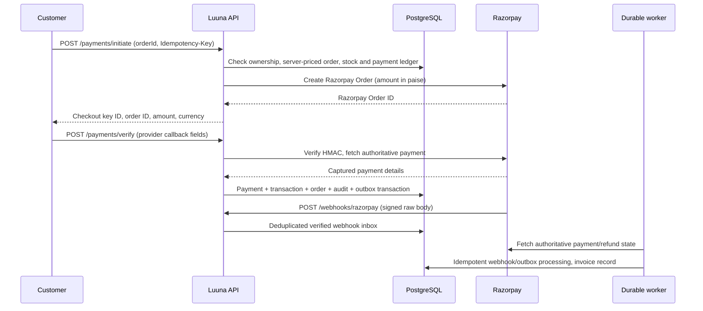
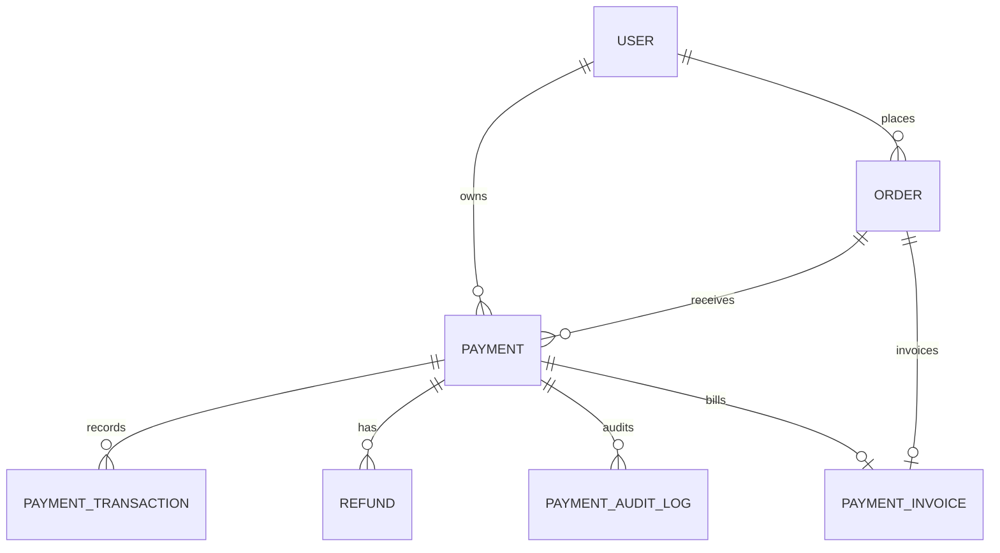

# Razorpay payments: API and operations

This backend uses the existing NestJS API and Prisma/PostgreSQL database. There is no `/api` global prefix, so the routes below are mounted as written.

Provider contracts follow the [Razorpay Orders API](https://razorpay.com/docs/api/orders/create/), [webhook signature and delivery guidance](https://razorpay.com/docs/webhooks/validate-test/), and [payment webhook event payloads](https://razorpay.com/docs/webhooks/payments/).

## Payment lifecycle



## Payment data model



## Endpoints

All customer payment endpoints require JWT authentication and only expose the current user's records.

| Method and route | Access | Purpose |
| --- | --- | --- |
| `POST /payments/initiate` | Customer | Body `{ "orderId": "..." }`; optional `Idempotency-Key` header. Returns Razorpay checkout details. |
| `POST /payments/verify` | Customer | Verifies callback signature and fetches provider payment before confirming capture. |
| `GET /payments/history` | Customer | Up to 100 newest payments for the authenticated user. |
| `GET /payments/:id` | Owner | Payment plus transaction/refund ledger. |
| `GET /payments/:id/invoice` | Owner | Returns a private S3 download URL valid for 10 minutes when the invoice is ready. |
| `POST /webhooks/razorpay` | Razorpay | Validates `X-Razorpay-Signature` over raw bytes and deduplicates `X-Razorpay-Event-Id`. Responds `202` after durable insert. |
| `GET /admin/payments` | Admin | Latest 100 payment records. |
| `GET /admin/payments/:id` | Admin | Payment, order, transaction, refund, audit details. |
| `GET /admin/payments/failed` | Admin | Failed payment records. |
| `GET /admin/payments/failed-webhooks` | Admin | Failed webhook inbox records. |
| `POST /admin/payments/failed-webhooks/:id/reprocess` | Admin | Requeues a failed webhook from its verified durable record. |
| `GET /admin/payments/failed-outbox-events` | Admin | Outbox events that exhausted automatic retries. |
| `POST /admin/payments/failed-outbox-events/:id/reprocess` | Admin | Requeues a failed outbox event. |
| `GET /admin/payments/reconciliation` | Admin | Compares local records with Razorpay order payment attempts and records discrepancies without auto-correcting the ledger. |
| `POST /admin/refunds` | Admin | Body `{ "paymentId": "...", "amount": 25.00, "reason": "..." }`; requires `Idempotency-Key`. |
| `GET /admin/refunds` | Admin | Latest 100 refund records. |
| `GET /admin/refunds/:id` | Admin | Refund and payment detail. |

## Data and migration

Migration `20261117120000_add_razorpay_payments` adds payment, transaction, webhook inbox, refund, outbox, audit, and online-order invoice tables, with fixed precision monetary columns and unique provider/idempotency identifiers. It adds `RAZORPAY` to the existing order payment-method enum and a partial unique index that allows only one active online payment per order. Existing POS billing invoices are unchanged.

The integration uses the official Razorpay Node SDK. Razorpay order amounts and webhook amounts are integer paise; internal values remain INR decimal amounts. Order creation now calculates prices, discount, and tax from backend product data. Payment initiation rechecks the immutable order snapshot against catalog pricing, tax, stock, and totals; changed catalog values require a replacement order.

## Configuration and deployment

Set these server-side values in the deployment secret store:

```env
PAYMENTS_ENABLED=false
RAZORPAY_KEY_ID=
RAZORPAY_KEY_SECRET=
RAZORPAY_WEBHOOK_SECRET=
PAYMENT_CURRENCY=INR
EMAIL_PAYMENT_NOTIFICATIONS_ENABLED=false
PAYMENT_EXPIRATION_MINUTES=30
PAYMENT_RECONCILIATION_ENABLED=true
PAYMENT_RECONCILIATION_INTERVAL_MINUTES=60
```

Keep payments disabled until test credentials and a webhook secret are set. Use distinct test/live credentials. Register the production webhook as `https://<api-host>/webhooks/razorpay` and enable `payment.authorized`, `payment.captured`, `payment.failed`, `order.paid`, `refund.created`, `refund.processed`, and `refund.failed`. Razorpay event bodies are snapshots and delivery can be duplicated or out of order; the worker fetches current provider state before applying important transitions.

Apply the additive database migration with `npm run prisma:migrate:deploy`, deploy the updated API, configure AWS S3/SES credentials already used by the backend, then enable payment initiation. No Redis service is required: the app polls durable PostgreSQL webhook/outbox tables every five seconds. Run at least one API instance with the worker enabled; use a single worker instance or add database lease coordination before scaling API replicas. This worker is intentionally small and currently shares the API process.

## Recoverability and security

- Invalid signatures are rejected before persistence. Valid webhook payloads are reduced to payment/refund identifiers and state fields before storage.
- Duplicate event IDs are ignored by a unique constraint. Failed inbox work is retried up to eight times and remains queryable in PostgreSQL for operator reprocessing.
- Capture, order confirmation state, transaction, audit record, and outbox event commit atomically. Email and invoice failures cannot roll back capture.
- Refund requests lock the payment row and reserve pending refunds when enforcing the refundable balance. Provider response is not treated as final settlement; refund webhooks update the ledger.
- Customer invoice links are short-lived S3 signed URLs. Card number, CVV, and authentication data are not stored.
- Admin payment/refund routes require JWT role `Admin`; payment reads enforce order ownership.
- Do not expose `RAZORPAY_KEY_SECRET` or `RAZORPAY_WEBHOOK_SECRET` to frontend code or logs. Production endpoints must use HTTPS.

## Current limitations

- The durable worker retries webhook/outbox events, expires pending payments, and runs scheduled reconciliation inside the API process; use one worker instance until database lease/heartbeat coordination is added.
- Email uses existing SES and is opt-in through `EMAIL_PAYMENT_NOTIFICATIONS_ENABLED`; exhausted retries are visible and can be reprocessed through the admin outbox endpoints, but there is no separate alerting system.
- Reconciliation runs on a configured cadence and is also available through the admin route. It records discrepancies and never automatically rewrites financial status.
- Pending orders are cancelled after the configured expiry only after checking Razorpay state. The existing inventory model has no order-level reservation ledger, so this integration does not reserve or release stock; the payment initiation rechecks current availability.
- Refund API timeouts deliberately leave the local refund pending for webhook/reconciliation rather than risking a duplicate provider request.
- Configure real credentials, test webhook delivery, AWS S3/SES permissions, and merchant dashboard events before production activation. Automated tests mock the gateway and do not make financial transactions.
